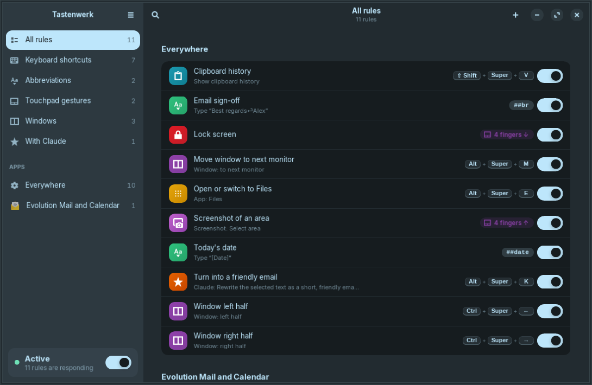
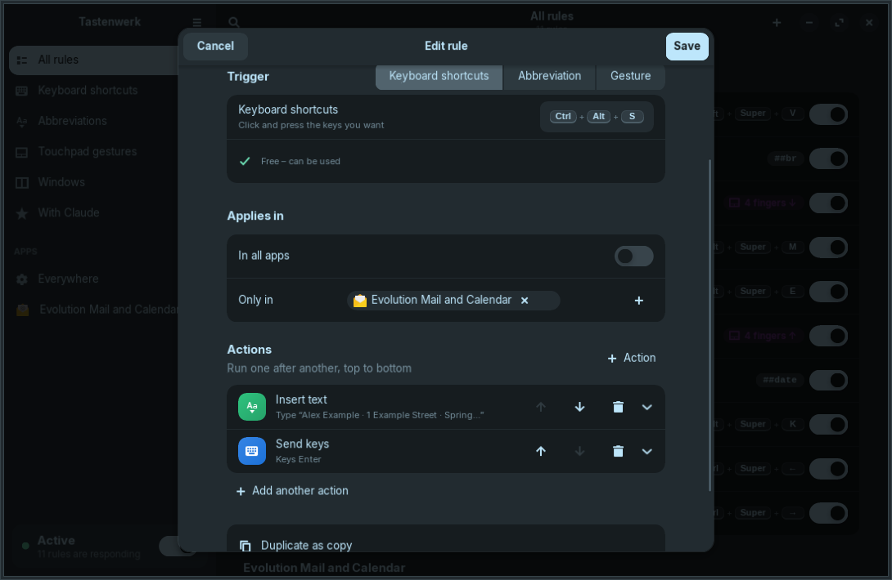
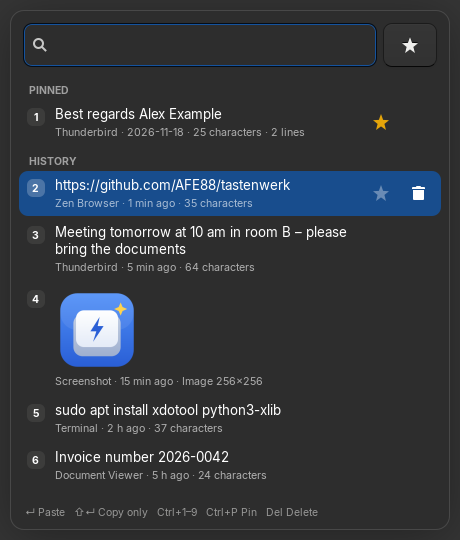
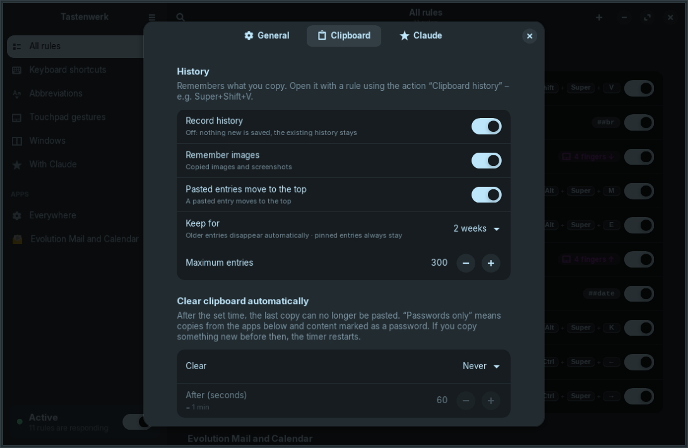

<div align="center">

[Deutsch](README.md) · **English**


# Tastenwerk

**Keyboard shortcuts, text snippets, touchpad gestures and a clipboard history for Linux – in one app.**

A BetterTouchTool replacement for Zorin OS, Ubuntu, Linux Mint and other Linux systems running X11.

[](https://github.com/AFE88/tastenwerk/releases)
[](LICENSE)


<br>



</div>

<br>

## What Tastenwerk does

| | |
|---|---|
| ⌨️ **Keyboard shortcuts** | Any combination, system-wide or only in specific apps. Tastenwerk warns you when GNOME already uses a shortcut. |
| ✍️ **Text snippets** | Type `##br` and your sign-off appears. With placeholders for date, time, clipboard and cursor position. |
| 👆 **Touchpad gestures** | Swipe and pinch with 3–5 fingers, e.g. 4 fingers down = lock the screen. |
| 📋 **Clipboard history** | Everything you copy, including images – with search, pinning and pasting by keyboard. |
| 🪟 **Windows & apps** | Tile windows, move them to other monitors, launch apps or bring them to the front. |
| ✨ **Rewrite with Claude** | Rewrite selected text with a shortcut, e.g. as a friendly email – using your Claude subscription, no API key. |
| 🤖 **Set up with Claude** | Claude Code can read, check and create your rules through a built-in MCP server: “Give Obsidian a free shortcut.” |
| 🔗 **Macros** | Several actions in a row: insert text, send keys, wait, run a command, take a screenshot … |
| 🍏 **Coming from the Mac** | Import BetterTouchTool presets – an assistant translates ⌘ shortcuts, text snippets and gestures. |
| 🔔 **Tray icon** | In the top bar: status, clipboard, pause all shortcuts (e.g. for games), open the window. |
| 🌍 **English & German** | Follows your system language, can be changed in the preferences. More languages are easy to add. |

Everything is set up in a clean interface: record shortcuts by pressing them, perform gestures right
on the touchpad, pick apps from a list.

<table>
<tr>
<td width="62%"></td>
<td width="38%"></td>
</tr>
<tr>
<td align="center"><sub>Rule editor: trigger, apps and actions</sub></td>
<td align="center"><sub>Clipboard history with search and images</sub></td>
</tr>
</table>

## Installation

**Requirement:** a Linux session running **X11**. Under Wayland, apps cannot capture global shortcuts.
Tastenwerk is tested on **Zorin OS 18**. It should also run on **Ubuntu 24.04**, **Linux Mint 22**,
**Debian 13**, **Fedora** and **Arch** (details below).

**Ubuntu, Zorin, Mint, Debian, elementary OS:**

```bash
sudo apt install git python3-gi gir1.2-gtk-4.0 gir1.2-gtk-3.0 gir1.2-adw-1 python3-xlib python3-yaml xdotool
git clone https://github.com/AFE88/tastenwerk.git ~/tastenwerk
~/tastenwerk/bin/tastenwerk install
```

**Tastenwerk** then appears in your app menu. To update: `git -C ~/tastenwerk pull`.

<details>
<summary><b>Fedora, Arch and other systems</b></summary>

<br>

**Fedora:**

```bash
sudo dnf install git python3-gobject gtk4 gtk3 libadwaita python3-xlib python3-pyyaml xdotool
```

**Arch, Manjaro, EndeavourOS:**

```bash
sudo pacman -S git python-gobject gtk4 gtk3 libadwaita python-xlib python-yaml xdotool
```

Then `git clone …` and `tastenwerk install` as above.

Tastenwerk needs an **X11 session**, **libadwaita 1.5** or newer and **Python 3.10** or newer:

| System | Works? | Note |
|---|---|---|
| Zorin OS 18 | ✅ tested | GNOME 46 on X11 |
| Ubuntu 24.04 LTS | ✅ | choose “Ubuntu on Xorg” at login |
| Linux Mint 22 (Cinnamon, MATE, Xfce) | ✅ | these desktops run on X11 by default |
| elementary OS 8 | ✅ | choose the X11 session |
| Debian 13 “Trixie” | ✅ | with an X11 session |
| Fedora 40+ with Xfce, KDE, Cinnamon or MATE | ✅ | with an X11 session |
| Arch, Manjaro, EndeavourOS, openSUSE Tumbleweed | ✅ | with an X11 desktop |
| Debian 12, Ubuntu 22.04, Mint 21, Pop!_OS 22.04, Zorin 17 | ❌ | libadwaita too old |
| Ubuntu 25.10 / 26.04, Fedora 41+ with GNOME | ❌ | GNOME no longer offers X11 there |

Only Zorin OS 18 has actually been tested so far; the other entries are derived from package versions.
Feedback is welcome – feel free to open an [issue](https://github.com/AFE88/tastenwerk/issues).

Outside of GNOME almost everything works the same. Only the conflict check knows GNOME shortcuts
exclusively, the screenshot action sends the Print key there, and locking uses `loginctl lock-session`.

**Optional:** touchpad gestures need the **Touchégg** service (included in Zorin), text rewriting needs
the **Claude Code CLI** (see below).

</details>

## Getting started

1. Open **Tastenwerk** from the app menu.
2. Create a rule with **+**: choose a trigger (shortcut, abbreviation or gesture), then add one or more
   actions.
3. Switch the toggle at the bottom left to **Active**. Autostart can be turned on in the preferences.

The background service keeps responding when the window is closed. Rules live in
`~/.config/tastenwerk/config.yaml` and can also be edited by hand – changes take effect immediately.

## Clipboard history

Tastenwerk remembers what you copy and shows it centered over the active window at the press of a key.
You choose the shortcut yourself: a rule with the action “Clipboard history”, for example on
**Super+Shift+V** (that's how the example configuration sets it up).

| Key | Effect |
|---|---|
| type | search instantly (several words = all must match) |
| ↑ ↓ / ↵ | select / paste |
| Ctrl+1 … 9 | paste entry 1–9 directly |
| ⇧↵ or Ctrl+C | only put it on the clipboard |
| Ctrl+P | pin (always kept, shown at the top) |
| Del | delete entry |
| Tab | show pinned entries only |
| Esc | clear search / close |

- **Without the window:** the action “Paste entry directly” (`clipboard: paste 2`) pastes the
  second-to-last copy. With every press it switches between the last two copies.
- **Passwords stay out:** copies from password managers (Bitwarden, KeePassXC …) and content marked as a
  password are never saved. If you like, Tastenwerk clears the clipboard after a time you choose.
- **Local only:** the history lives in `~/.local/share/tastenwerk/clipboard/` and is readable only by
  you. Keep entries for 1 hour up to 1 year, or forever.
- **In terminals** it pastes with Ctrl+Shift+V automatically.

<p align="center">

</p>

## Touchpad gestures

In the rule editor choose the trigger **Gesture**, click “Record gesture” and simply swipe on the
touchpad. Like shortcuts, gestures can be limited to specific apps.

Tastenwerk uses the **Touchégg** service for this, without root privileges. In GNOME, 3-finger swipes
and 4-finger pinches are already taken – Tastenwerk warns about overlaps. **4- and 5-finger swipes are
free.**

## Rewrite text with Claude

The action “Rewrite with Claude” sends the selected text (or the line before the cursor) to Claude and
replaces it with the answer – for example “Rewrite this as a friendly email”. It runs through the
**Claude Code CLI with your subscription**; no API key is needed. One-time setup:

```bash
curl -fsSL https://claude.ai/install.sh | bash
claude auth login
```

Without the CLI everything else works as usual.

## Set up rules with Claude (MCP)

Tastenwerk includes a small **MCP server**. It lets Claude Code read your rules, find free shortcuts
and create new rules, for example “Add a shortcut that brings Obsidian to the front, and minimize it
when it already is”. Claude uses the same checks as the interface: it learns whether a shortcut is
already taken by another rule or by GNOME, and it never writes a broken configuration. Changes apply
immediately. One-time setup (needs the Claude Code CLI, see above):

```bash
tastenwerk mcp --install
```

Afterwards Tastenwerk is available in new Claude Code sessions (`/mcp` shows the status). Remove it
with `tastenwerk mcp --uninstall`.

Deliberately **not** exposed: the clipboard history (it can contain passwords), window titles, and
triggering actions or key presses. Claude only changes the configuration, and Claude Code asks
before every change.

## Coming from BetterTouchTool

In the window via **Menu → Import from BetterTouchTool …** (Ctrl+I) or in a terminal:

```bash
~/tastenwerk/bin/tastenwerk import ~/Downloads/*.bttpreset
```

The assistant classifies every BTT trigger (✅ direct · 🟡 adapted · 🛠 manual work · ⛔ not
transferable), asks which Linux key replaces ⌘ and which Linux apps replace your Mac apps, and checks
for overlaps. It brings over keyboard shortcuts, abbreviations, swipe gestures, text snippets
(multi-line, with emojis), Mac special characters (⌥7 = |), window actions, screenshots and ChatGPT
rewrites (these become Claude).

Importing **again** with newer presets skips anything unchanged and offers changed rules for updating.
Your own `config.yaml` stays untouched. (The import assistant's notes are currently in German.)

## Mouse and special keys

Tastenwerk doesn't map mouse buttons itself. Your mouse or keyboard software (e.g. OpenLogi, Solaar,
Piper) can run Tastenwerk commands though – which is more reliable than a simulated shortcut:

| Command | Effect |
|---|---|
| `~/tastenwerk/bin/tastenwerk clipboard` | open the clipboard history |
| `~/tastenwerk/bin/tastenwerk clipboard paste 2` | paste the second-to-last copy |
| `~/tastenwerk/bin/tastenwerk screenshot` | screenshot with area selection |

<details>
<summary><b>Writing rules by hand (YAML)</b></summary>

<br>

```yaml
rules:
  - name: Window left
    hotkey: ctrl+super+left
    do: [{window: left_half}]

  - name: Sign-off
    abbreviation: "##br"
    do:
      - type: |-
          Best regards
          {cursor}

  - name: Files
    hotkey: alt+super+e
    do: [{app: org.gnome.Nautilus}]   # if running: bring to front, otherwise start

  - name: Lock
    gesture: swipe down 4             # swipe up/down/left/right · pinch in/out · 3–5 fingers
    do: [{lock: true}]

  - name: Only in VS Code
    abbreviation: "##api"
    apps: [code]
    do: [{type: "function {cursor}() {{ }}"}]
```

All actions and placeholders are described in [`config.example.yaml`](config.example.yaml) (comments in
German): `keys`, `type`, `paste`, `app`, `window`, `workspace`, `open`, `run`, `delay`, `lock`,
`notify`, `ai`, `clipboard`, `screenshot`.

</details>

<details>
<summary><b>All terminal commands</b></summary>

<br>

| Command | Purpose |
|---|---|
| `tastenwerk` / `tastenwerk gui` | open the window |
| `tastenwerk run [--debug]` | run the background service in a terminal |
| `tastenwerk check` | check the configuration, including overlaps with GNOME shortcuts |
| `tastenwerk list [--all]` | list all rules |
| `tastenwerk apps [--wait 3]` | find app names for `apps:` |
| `tastenwerk import FILE…` | import BetterTouchTool presets |
| `tastenwerk reload` / `stop` | reload / stop the running service |
| `tastenwerk clipboard [paste N \| clear]` | open the clipboard history, paste an entry, clear it |
| `tastenwerk screenshot [area \| screen \| window]` | screenshot with the GNOME tool |
| `tastenwerk mcp --install` | Add Tastenwerk to Claude Code (MCP server) |
| `tastenwerk install` | add the app menu entry |
| `tastenwerk --version` | show the version |

</details>

## Translations

Tastenwerk is available in English and German; other system languages get English. Contributing a new
language is easy: copy `locale/en.po` to `locale/<language code>.po` (e.g. `fr.po`) and translate the
`msgstr` lines. After code changes, `python3 tools/extract_messages.py` collects new texts into all
language files. Contributions are welcome as pull requests.

## Good to know

- **X11 only.** On Zorin and Ubuntu choose the “… on Xorg” session at login.
- **Taken shortcuts:** if GNOME already uses a shortcut (e.g. Super+E), Tastenwerk can't use it. The
  window and `tastenwerk check` show such cases.
- **Abbreviations** trigger as soon as they are typed. A mouse click, arrow keys or Ctrl combinations
  reset the typing buffer. Typed characters are never logged.

## License

Tastenwerk is free software under the [GPL-3.0](LICENSE).
Found a bug or have an idea? Feel free to open an [issue on GitHub](https://github.com/AFE88/tastenwerk/issues).
