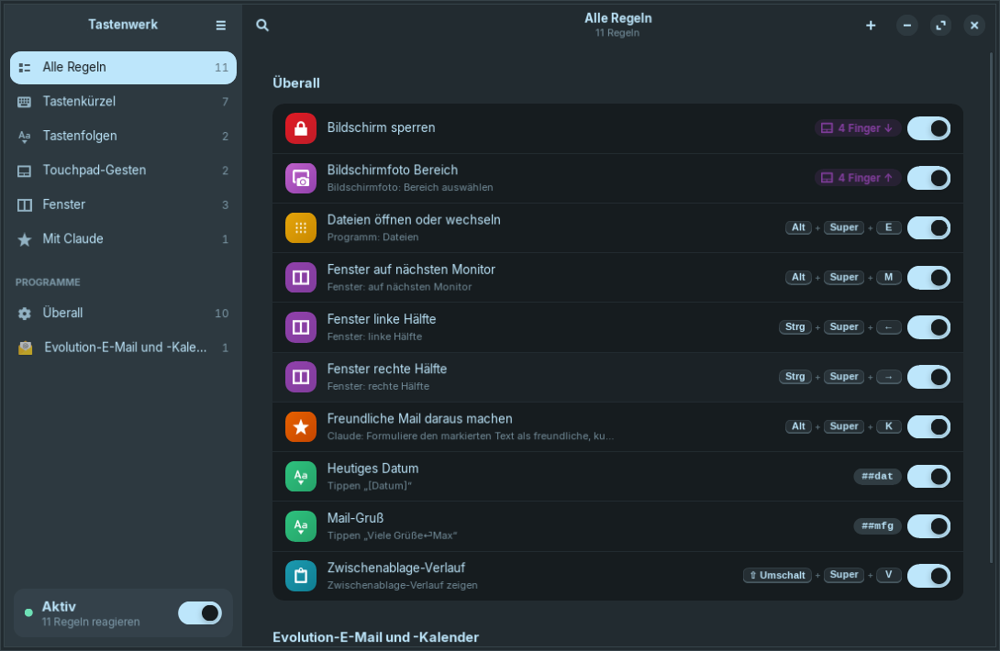
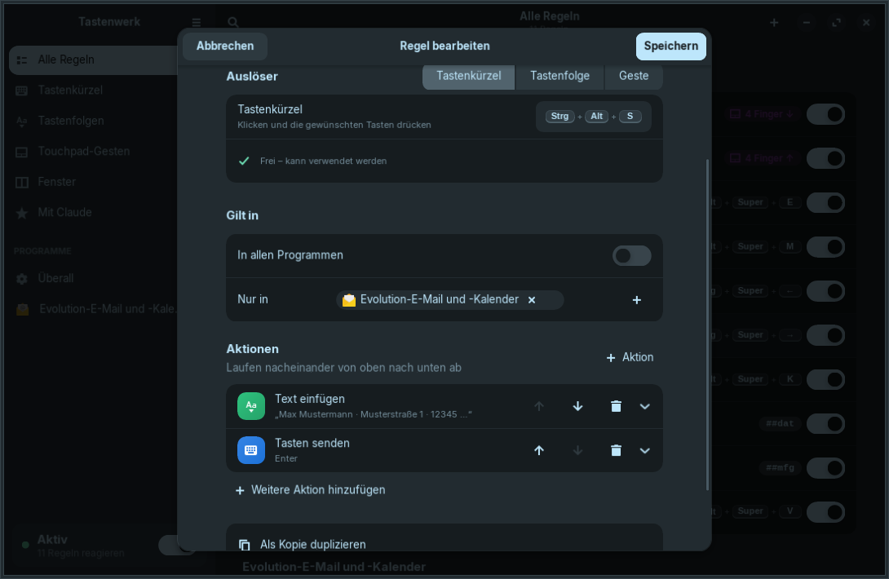
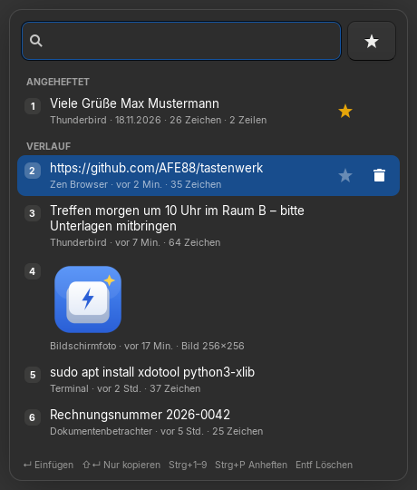
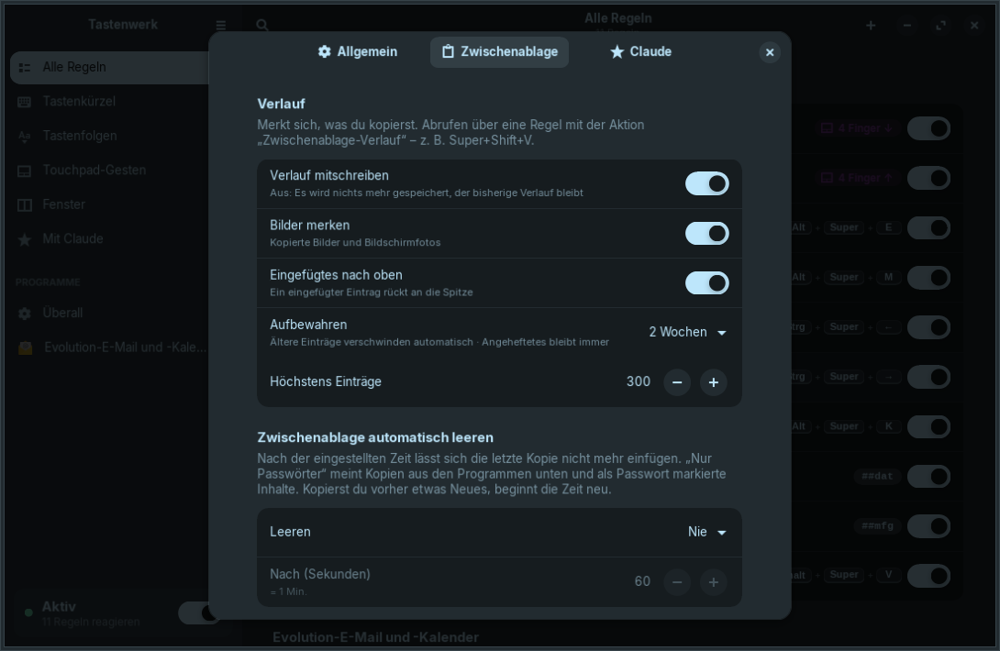

<div align="center">

**Deutsch** · [English](README.en.md)


# Tastenwerk

**Tastenkürzel, Text-Bausteine, Touchpad-Gesten und ein Zwischenablage-Verlauf für Linux – in einer App.**

Der BetterTouchTool-Ersatz für Zorin OS, Ubuntu, Linux Mint und andere Linux-Systeme mit X11.

[](https://github.com/AFE88/tastenwerk/releases)
[](LICENSE)


<br>



</div>

<br>

## Was Tastenwerk kann

| | |
|---|---|
| ⌨️ **Tastenkürzel** | Beliebige Kombinationen, systemweit oder nur in bestimmten Programmen. Tastenwerk warnt, wenn GNOME ein Kürzel schon belegt. |
| ✍️ **Text-Bausteine** | Tippe `##mfg` und es erscheint dein Gruß. Mit Platzhaltern für Datum, Uhrzeit, Zwischenablage und Cursorposition. |
| 👆 **Touchpad-Gesten** | Wischen und Zusammenziehen mit 3–5 Fingern, z. B. 4 Finger runter = Bildschirm sperren. |
| 📋 **Zwischenablage-Verlauf** | Alles, was du kopierst, inklusive Bilder – mit Suche, Anheften und Einfügen per Tastendruck. |
| 🪟 **Fenster & Programme** | Fenster andocken, auf andere Monitore schieben, Programme starten oder nach vorne holen. |
| ✨ **Mit Claude umformen** | Markierten Text per Kürzel umschreiben lassen, z. B. als freundliche Mail – über dein Claude-Abo, ohne API-Schlüssel. |
| 🤖 **Mit Claude einrichten** | Claude Code kann deine Regeln über einen eingebauten MCP-Server lesen, prüfen und anlegen: „Leg mir ein freies Kürzel für Obsidian an.“ |
| 🔗 **Makros** | Mehrere Aktionen hintereinander: Text einfügen, Tasten senden, warten, Befehl ausführen, Bildschirmfoto … |
| 🍏 **Umstieg vom Mac** | BetterTouchTool-Presets importieren – ein Assistent übersetzt ⌘-Kürzel, Text-Bausteine und Gesten. |
| 🔔 **Tray-Symbol** | In der oberen Leiste: Status, Zwischenablage, alle Kürzel pausieren (z. B. für Spiele), Oberfläche öffnen. |
| 🌍 **Deutsch & Englisch** | Folgt der Systemsprache, umstellbar in den Einstellungen. Weitere Sprachen lassen sich leicht ergänzen. |

Alles lässt sich in einer übersichtlichen Oberfläche einrichten: Kürzel per Tastendruck aufnehmen,
Gesten direkt auf dem Touchpad vormachen, Programme aus einer Liste wählen.

<table>
<tr>
<td width="62%"></td>
<td width="38%"></td>
</tr>
<tr>
<td align="center"><sub>Regel-Editor: Auslöser, Programme und Aktionen</sub></td>
<td align="center"><sub>Zwischenablage-Verlauf mit Suche und Bildern</sub></td>
</tr>
</table>

## Installation

**Voraussetzung:** eine Linux-Sitzung mit **X11**. Unter Wayland können Programme keine globalen
Kürzel abfangen. Getestet ist Tastenwerk auf **Zorin OS 18**. Es sollte auch auf **Ubuntu 24.04**,
**Linux Mint 22**, **Debian 13**, **Fedora** und **Arch** laufen (Details unten).

**Ubuntu, Zorin, Mint, Debian, elementary OS:**

```bash
sudo apt install git python3-gi gir1.2-gtk-4.0 gir1.2-gtk-3.0 gir1.2-adw-1 python3-xlib python3-yaml xdotool
git clone https://github.com/AFE88/tastenwerk.git ~/tastenwerk
~/tastenwerk/bin/tastenwerk install
```

Danach steht **Tastenwerk** im Programm-Menü. Aktualisieren geht mit `git -C ~/tastenwerk pull`.

<details>
<summary><b>Fedora, Arch und weitere Systeme</b></summary>

<br>

**Fedora:**

```bash
sudo dnf install git python3-gobject gtk4 gtk3 libadwaita python3-xlib python3-pyyaml xdotool
```

**Arch, Manjaro, EndeavourOS:**

```bash
sudo pacman -S git python-gobject gtk4 gtk3 libadwaita python-xlib python-yaml xdotool
```

Dann wie oben `git clone …` und `tastenwerk install`.

Tastenwerk braucht eine **X11-Sitzung**, **libadwaita 1.5** oder neuer und **Python 3.10** oder neuer:

| System | Läuft? | Hinweis |
|---|---|---|
| Zorin OS 18 | ✅ getestet | GNOME 46 auf X11 |
| Ubuntu 24.04 LTS | ✅ | beim Anmelden „Ubuntu auf Xorg“ wählen |
| Linux Mint 22 (Cinnamon, MATE, Xfce) | ✅ | Desktops laufen standardmäßig auf X11 |
| elementary OS 8 | ✅ | X11-Sitzung wählen |
| Debian 13 „Trixie“ | ✅ | mit X11-Sitzung |
| Fedora 40+ mit Xfce, KDE, Cinnamon oder MATE | ✅ | mit X11-Sitzung |
| Arch, Manjaro, EndeavourOS, openSUSE Tumbleweed | ✅ | mit X11-Desktop |
| Debian 12, Ubuntu 22.04, Mint 21, Pop!_OS 22.04, Zorin 17 | ❌ | libadwaita zu alt |
| Ubuntu 25.10 / 26.04, Fedora 41+ mit GNOME | ❌ | GNOME bietet dort kein X11 mehr an |

Nur Zorin OS 18 ist bisher wirklich getestet, die übrigen Angaben folgen aus den Paketversionen.
Rückmeldungen sind willkommen – gern als [Issue](https://github.com/AFE88/tastenwerk/issues).

Außerhalb von GNOME funktioniert fast alles genauso. Nur die Konfliktprüfung kennt ausschließlich
GNOME-Kürzel, das Bildschirmfoto sendet dort die Druck-Taste und das Sperren nutzt
`loginctl lock-session`.

**Optional:** Touchpad-Gesten brauchen den Dienst **Touchégg** (bei Zorin dabei), die
Textumformung das **Claude-Code-CLI** (siehe unten).

</details>

## Erste Schritte

1. **Tastenwerk** im Programm-Menü öffnen.
2. Mit **+** eine Regel anlegen: Auslöser wählen (Kürzel, Tastenfolge oder Geste), dann eine oder
   mehrere Aktionen hinzufügen.
3. Unten links den Schalter auf **Aktiv** stellen. In den Einstellungen lässt sich der Autostart
   einschalten.

Der Hintergrunddienst reagiert auch, wenn die Oberfläche geschlossen ist. Die Regeln liegen in
`~/.config/tastenwerk/config.yaml` und lassen sich auch von Hand bearbeiten – Änderungen greifen
sofort.

## Zwischenablage-Verlauf

Tastenwerk merkt sich, was du kopierst, und zeigt es auf Knopfdruck mittig über dem aktiven
Fenster an. Das Kürzel legst du selbst fest: eine Regel mit der Aktion „Zwischenablage-Verlauf“,
zum Beispiel auf **Super+Shift+V** (so ist es in der Beispiel-Konfiguration eingerichtet).

| Taste | Wirkung |
|---|---|
| tippen | sofort suchen (mehrere Wörter = alle müssen vorkommen) |
| ↑ ↓ / ↵ | auswählen / einfügen |
| Strg+1 … 9 | Eintrag 1–9 direkt einfügen |
| ⇧↵ oder Strg+C | nur in die Zwischenablage legen |
| Strg+P | anheften (bleibt immer, steht oben) |
| Entf | Eintrag löschen |
| Tab | nur Angeheftete zeigen |
| Esc | Suche leeren / schließen |

- **Ohne Fenster:** Die Aktion „Eintrag direkt einfügen“ (`clipboard: paste 2`) fügt die vorletzte
  Kopie ein. Bei jedem Druck wechselt sie zwischen den letzten beiden Kopien.
- **Passwörter bleiben draußen:** Kopien aus Passwort-Managern (Bitwarden, KeePassXC …) und als
  Passwort markierte Inhalte werden nie gespeichert. Auf Wunsch leert Tastenwerk die Zwischenablage
  nach einer einstellbaren Zeit.
- **Nur lokal:** Der Verlauf liegt in `~/.local/share/tastenwerk/clipboard/` und ist nur für dich
  lesbar. Aufbewahrung: 1 Stunde bis 1 Jahr oder unbegrenzt.
- **Im Terminal** wird automatisch mit Strg+Shift+V eingefügt.

<p align="center">

</p>

## Touchpad-Gesten

Im Regel-Editor den Auslöser **Geste** wählen, auf „Geste aufnehmen“ klicken und einfach auf dem
Touchpad wischen. Gesten lassen sich wie Kürzel auf einzelne Programme beschränken.

Tastenwerk nutzt dafür den Dienst **Touchégg**, ohne Root-Rechte. Unter GNOME sind 3 Finger und
4 Finger Zusammenziehen schon belegt – Tastenwerk warnt bei Überschneidungen. **4 und 5 Finger
Wischen sind frei.**

## Text mit Claude umformen

Die Aktion „Mit Claude umformen“ schickt markierten Text (oder die Zeile vor dem Cursor) an Claude
und ersetzt ihn durch die Antwort – zum Beispiel „Formuliere das als freundliche Mail“. Das läuft
über das **Claude-Code-CLI mit deinem Abo**, ein API-Schlüssel ist nicht nötig. Einmalig einrichten:

```bash
curl -fsSL https://claude.ai/install.sh | bash
claude auth login
```

Ohne CLI funktioniert alles andere ganz normal.

## Regeln mit Claude einrichten (MCP)

Tastenwerk bringt einen kleinen **MCP-Server** mit. Damit kann Claude Code deine Regeln lesen,
freie Kürzel suchen und neue Regeln anlegen, zum Beispiel „Leg mir ein Kürzel an, das Obsidian holt,
und minimier es, wenn es schon vorne ist“. Claude nutzt dabei dieselbe Prüfung wie die Oberfläche:
Es erfährt, ob ein Kürzel schon von einer anderen Regel oder von GNOME belegt ist, und legt keine
fehlerhafte Konfiguration ab. Änderungen gelten sofort. Einmalig einrichten (braucht das Claude-Code-CLI, siehe oben):

```bash
tastenwerk mcp --install
```

Danach steht Tastenwerk in neuen Claude-Code-Sitzungen bereit (`/mcp` zeigt den Stand). Austragen
geht mit `tastenwerk mcp --uninstall`.

Bewusst **nicht** freigegeben: der Zwischenablage-Verlauf (er kann Passwörter enthalten), Fenstertitel
und das Auslösen von Aktionen oder Tastendrücken. Claude ändert nur die Konfiguration, und Claude Code
fragt vor jeder Änderung nach.

## Umstieg von BetterTouchTool

In der Oberfläche über **Menü → Aus BetterTouchTool importieren …** (Strg+I) oder im Terminal:

```bash
~/tastenwerk/bin/tastenwerk import ~/Downloads/*.bttpreset
```

Der Assistent ordnet jeden BTT-Auslöser ein (✅ direkt · 🟡 angepasst · 🛠 Handarbeit · ⛔ nicht
übertragbar), fragt, welche Linux-Taste ⌘ ersetzt und welche Linux-Programme deine Mac-Programme
ersetzen, und prüft Überschneidungen. Er übernimmt Tastenkürzel, Tastenfolgen, Wischgesten,
Text-Bausteine (auch mehrzeilig, mit Emojis), Mac-Sonderzeichen (⌥7 = |), Fenster-Aktionen,
Bildschirmfotos und ChatGPT-Umformungen (werden zu Claude).

Ein **erneuter Import** mit neueren Presets überspringt Unverändertes und bietet geänderte Regeln
zum Aktualisieren an. Deine eigene `config.yaml` bleibt dabei unangetastet.

## Maus- und Sondertasten

Maustasten belegt Tastenwerk nicht selbst. Deine Maus- oder Tastatur-Software (z. B. OpenLogi,
Solaar, Piper) kann aber Tastenwerk-Befehle auslösen – das ist zuverlässiger als ein vorgetäuschtes
Tastenkürzel:

| Befehl | Wirkung |
|---|---|
| `~/tastenwerk/bin/tastenwerk clipboard` | Zwischenablage-Verlauf öffnen |
| `~/tastenwerk/bin/tastenwerk clipboard paste 2` | vorletzte Kopie einfügen |
| `~/tastenwerk/bin/tastenwerk screenshot` | Bildschirmfoto mit Bereichsauswahl |

<details>
<summary><b>Regeln von Hand schreiben (YAML)</b></summary>

<br>

```yaml
rules:
  - name: Fenster links
    hotkey: ctrl+super+left
    do: [{window: left_half}]

  - name: Gruß
    abbreviation: "##mfg"
    do:
      - type: |-
          Viele Grüße
          {cursor}

  - name: Dateien
    hotkey: alt+super+e
    do: [{app: org.gnome.Nautilus}]   # läuft es: nach vorne holen, sonst starten

  - name: Sperren
    gesture: swipe down 4             # swipe up/down/left/right · pinch in/out · 3–5 Finger
    do: [{lock: true}]

  - name: Nur in VS Code
    abbreviation: "##api"
    apps: [code]
    do: [{type: "function {cursor}() {{ }}"}]
```

Alle Aktionen und Platzhalter sind in [`config.example.yaml`](config.example.yaml) beschrieben:
`keys`, `type`, `paste`, `app`, `window`, `workspace`, `open`, `run`, `delay`, `lock`, `notify`,
`ai`, `clipboard`, `screenshot`.

</details>

<details>
<summary><b>Alle Befehle im Terminal</b></summary>

<br>

| Befehl | Zweck |
|---|---|
| `tastenwerk` / `tastenwerk gui` | Oberfläche öffnen |
| `tastenwerk run [--debug]` | Hintergrunddienst im Terminal starten |
| `tastenwerk check` | Konfiguration prüfen, auch auf Überschneidungen mit GNOME-Kürzeln |
| `tastenwerk list [--all]` | alle Regeln anzeigen |
| `tastenwerk apps [--wait 3]` | Programmnamen für `apps:` herausfinden |
| `tastenwerk import DATEI…` | BetterTouchTool-Presets übernehmen |
| `tastenwerk reload` / `stop` | laufenden Dienst neu laden / beenden |
| `tastenwerk clipboard [paste N \| clear]` | Zwischenablage-Verlauf öffnen, Eintrag einfügen, leeren |
| `tastenwerk screenshot [area \| screen \| window]` | Bildschirmfoto mit dem GNOME-Werkzeug |
| `tastenwerk mcp --install` | Tastenwerk in Claude Code eintragen (MCP-Server) |
| `tastenwerk install` | Eintrag im Programm-Menü anlegen |
| `tastenwerk --version` | Version anzeigen |

</details>

## Übersetzungen

Tastenwerk gibt es auf Deutsch und Englisch, andere Systemsprachen bekommen Englisch. Eine neue Sprache
beizusteuern ist einfach: `locale/en.po` nach `locale/<sprachcode>.po` kopieren (z. B. `fr.po`) und
die `msgstr`-Zeilen übersetzen. Nach Änderungen im Code sammelt `python3 tools/extract_messages.py`
neue Texte in alle Sprachdateien ein. Beiträge gern als Pull Request.

## Gut zu wissen

- **Nur X11.** Bei Zorin und Ubuntu beim Anmelden die Sitzung „… auf Xorg“ wählen.
- **Belegte Kürzel:** Hat GNOME ein Kürzel schon belegt (z. B. Super+E), kann Tastenwerk es nicht
  nutzen. Die Oberfläche und `tastenwerk check` zeigen solche Fälle an.
- **Tastenfolgen** lösen aus, sobald sie getippt sind. Mausklick, Pfeiltasten oder
  Strg-Kombinationen setzen den Tippspeicher zurück. Getippte Zeichen werden nie protokolliert.

<details>
<summary><b>Für Entwickler: Aufbau</b></summary>

<br>

```
tastenwerk/
  gui/           Oberfläche (GTK 4 + libadwaita): app, editor, importdlg, prefs, widgets
  daemon.py      Hintergrunddienst, lädt die Konfiguration bei Änderungen neu
  hotkeys.py     globale Kürzel (XGrabKey) mit Sicherheitsnetz über XRecord
  abbrev.py      Tastenfolgen (XRecord)
  gestures.py    Touchpad-Gesten (über den Touchégg-Dienst)
  clipboard.py   Zwischenablage-Verlauf und sein Fenster
  actions.py     alle Aktionen (xdotool, Zwischenablage, Befehle, Claude)
  mcp_server.py  MCP-Server für Claude (Regeln lesen, prüfen, anlegen)
  apps.py        installierte Programme und Fenster-Zuordnung
  tray.py        Symbol in der oberen Leiste (Ayatana AppIndicator)
  i18n.py        Übersetzungen (liest locale/*.po direkt)
  windows.py     Fenster andocken / Monitore (EWMH)
  config.py      Konfiguration, Includes, Prüfung
  store.py       Regeln lesen/schreiben für die Oberfläche
  control.py     Dienst steuern, Autostart, Menü-Eintrag
  gnome.py       GNOME-Kürzel auslesen (Konflikte)
  importer/      BetterTouchTool-Import (btt.py = Übersetzung, wizard.py = Assistent)
```

Geplant: Tastenfolgen optional erst nach Leerzeichen auslösen · Fenster auf andere Arbeitsfläche
schieben.

</details>

## Lizenz

Tastenwerk ist freie Software unter der [GPL-3.0](LICENSE).
Fehler gefunden oder eine Idee? Gern als [Issue auf GitHub](https://github.com/AFE88/tastenwerk/issues).
